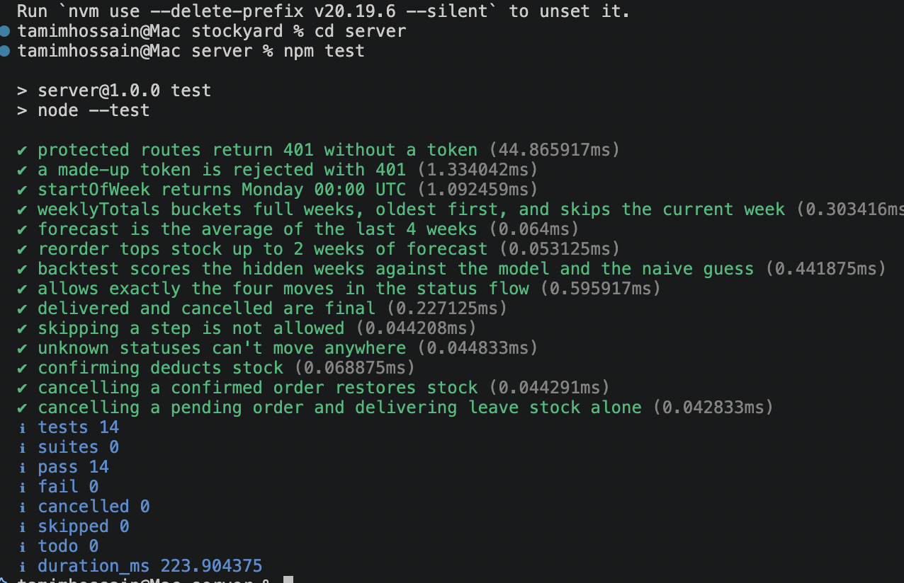
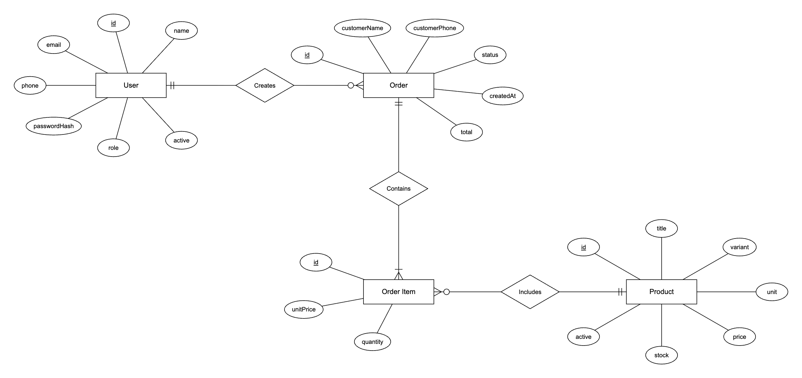
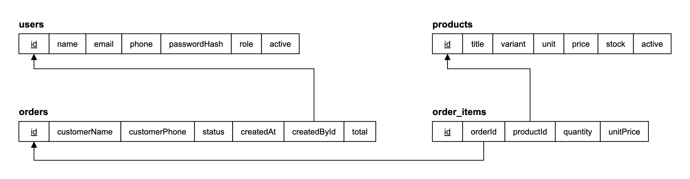

# StockYard

StockYard is a web app for small construction-material shops in Bangladesh to record orders and stock, and to see which products need restocking based on past sales.
Built for the NT Tech Innovation Full Stack Developer assessment (October 2026).

**Live demo:**    https://stockyard-lake.vercel.app/
API health check: https://stockyard-h1q6.onrender.com/api/health

**Demo logins:**

| Role | Email | Password |
|---|---|---|
| Admin | admin@stockyard.demo | Admin@1234 |
| Manager | manager@stockyard.demo | Manager@1234 |

The API runs on Render's free tier and sleeps after 15 idle minutes, so the first request can take about a minute.

## Problem
Shops that sell construction and hardware materials usually record their orders, sales and stock by hand on paper. Because of this, they have no reliable stock count, no sales history to analyze, and no clear picture of how sales are performing. When I visited my uncle’s construction shop in our local market, he could not say exactly how much stock he had. He didn’t know when to restock, which products to buy or in what quantity, and he had no way to estimate upcoming sales. StockYard records orders and stock digitally and uses past sales to forecast demand, giving the owner an approximate idea of upcoming sales and a list of products to restock.

## What it does
- **Products:** list the products, add a new one, update stock after a delivery or a recount, and archive products the shop no longer sells. Only the admin can change prices.
- **Orders:** create an order for a customer with one or more items. The server sets the prices and the total.
- **Status flow:** move orders through Pending → Confirmed → Delivered, or cancel them. Confirming takes the items out of stock, and cancelling a confirmed order puts them back.
- **Forecast:** see next week's expected sales for each product, and how much to reorder when stock is running low.

## Tech stack
- **Frontend:** React with Vite. It's a small app with no router library: pages are switched through the URL hash, so it can be hosted as a static site.
- **Backend:** Node.js with Express 5. Express 5 passes errors from async routes to the error handler on its own, so routes need no try/catch.
- **Database:** PostgreSQL with Prisma. The schema is in one file, migrations are generated from it, and queries are type-checked against it.
- **Auth:** bcryptjs for password hashes and JSON Web Tokens (jsonwebtoken) for logins.
- **Validation:** zod schemas on every request body and parameter.
- **Tests:** Node's built-in test runner run ## npm test ## for testing the total server test.
 expect result:


## Architecture
```
React (Render static site) ──HTTPS + Bearer token──▶ Express API (Render web service) ──Prisma──▶ PostgreSQL (Render)
```
- The client keeps the token from `POST /api/auth/login` in localStorage and sends it as `Authorization: Bearer <token>` on every request.
- **Login is checked** by the `requireAuth` middleware. It verifies the token and puts `{ id, role }` on `req.user`. Every route except login and health uses it.
- **Roles are checked** by `requireRole("ADMIN", ...)` on routes with a role rule, such as changing a price. The client hides buttons the user can't use, but the server is what enforces it.
- Business rules live in plain functions in `server/src/lib/`: the order status moves and the forecast maths. That keeps them testable without a database.


## Database design

PostgreSQL, managed with Prisma (`server/prisma/schema.prisma`). There are 4 tables and 2 enums.

### ER diagram



### Relational schema

Arrows go from each foreign key to the primary key it references.



### Table list

| Table | What one row is | Rows link to |
|---|---|---|
| `users` | A shop staff account (admin or manager) | — |
| `products` | One product variant, e.g. BSRM Rod 12mm | — |
| `orders` | One customer order | `users` (who created it) |
| `order_items` | One product line inside an order | `orders`, `products` |

#### users

| Column | Type | Key / constraint | Description |
|---|---|---|---|
| `id` | Int | **PK**, auto-increment | |
| `name` | String | required | Staff member's name |
| `email` | String | **unique**, required | Used to log in |
| `phone` | String | optional | |
| `passwordHash` | String | required | bcrypt hash, never the password itself |
| `role` | `Role` enum | required | `ADMIN` or `MANAGER` |
| `active` | Boolean | default `true` | An inactive user can't log in |

#### products

| Column | Type | Key / constraint | Description |
|---|---|---|---|
| `id` | Int | **PK**, auto-increment | |
| `title` | String | required, **unique with `variant`** | e.g. BSRM Rod |
| `variant` | String | required, **unique with `title`** | e.g. 12mm |
| `unit` | String | required | bag, ton, cft or piece |
| `price` | Decimal(12, 2) | required | Current price per unit, in BDT |
| `stock` | Decimal(12, 3) | required | Quantity in stock, in `unit` |
| `active` | Boolean | default `true` | Archiving a product sets it to `false` |

#### orders

| Column | Type | Key / constraint | Description |
|---|---|---|---|
| `id` | Int | **PK**, auto-increment | |
| `customerName` | String | required | |
| `customerPhone` | String | required | |
| `status` | `OrderStatus` enum | default `PENDING` | `PENDING`, `CONFIRMED`, `DELIVERED` or `CANCELLED` |
| `createdAt` | DateTime | default `now()` | Time of the order |
| `createdById` | Int | **FK → `users.id`** | Staff member who created the order |
| `total` | Decimal(12, 2) | required | Calculated by the server from the items |

#### order_items

| Column | Type | Key / constraint | Description |
|---|---|---|---|
| `id` | Int | **PK**, auto-increment | |
| `orderId` | Int | **FK → `orders.id`** | The order this line belongs to |
| `productId` | Int | **FK → `products.id`** | The product sold |
| `quantity` | Decimal(12, 3) | required | Amount sold, in the product's unit |
| `unitPrice` | Decimal(12, 2) | required | Price at the time of sale |

### Relationships

| Relationship | Type | Foreign key |
|---|---|---|
| A user creates zero or more orders; each order has exactly one creator | One-to-many | `orders.createdById` → `users.id` |
| An order contains one or more items; each item belongs to exactly one order | One-to-many | `order_items.orderId` → `orders.id` |
| A product appears in zero or more items; each item is for exactly one product | One-to-many | `order_items.productId` → `products.id` |

### Enums

| Enum | Values |
|---|---|
| `Role` | `ADMIN`, `MANAGER` |
| `OrderStatus` | `PENDING`, `CONFIRMED`, `DELIVERED`, `CANCELLED` |

### Key decisions
- One users table with roles: <why>
- Order items store the price at the time of sale: <why>
- Products are archived, not deleted: <why>
- Decimal for money and quantities: <why>

## Key APIs
All routes start with `/api`. "Logged in" means any admin or manager.

| Method | Path | Who can call it | What it does |
|---|---|---|---|
| POST | /auth/login | Anyone | Checks email and password, returns `{ token, name, role }` |
| GET | /auth/me | Logged in | Returns the current user's `{ id, role }` |
| GET | /products | Logged in | Lists active products |
| POST | /products | Admin, manager | Creates a product |
| PATCH | /products/:id/stock | Admin, manager | Sets the stock count |
| PATCH | /products/:id/price | Admin | Changes the price |
| PATCH | /products/:id/archive | Admin, manager | Archives a product (`active = false`) |
| POST | /orders | Logged in | Creates an order. Prices and total come from the database |
| GET | /orders?status= | Logged in | Lists orders, newest first, with an optional status filter |
| GET | /orders/:id | Logged in | One order with its items |
| PATCH | /orders/:id/status | Logged in | Moves an order to a new status (see below) |
| GET | /forecast | Logged in | Weekly sales, forecast and reorder suggestion per product |
| GET | /forecast/backtest | Logged in | Forecast accuracy against the naive baseline |
| GET | /health | Anyone | Checks the server and the database connection |

Errors always come back as `{ "message": "..." }`: 400 invalid input, 401 not logged in, 403 wrong role, 404 not found, 409 conflict (duplicate product, not enough stock).

## Order status flow
```
PENDING ──▶ CONFIRMED ──▶ DELIVERED
   │            │
   └──▶ CANCELLED ◀──┘
```
| Move | Effect on stock |
|---|---|
| Pending → Confirmed | Checks there's enough stock for every item and deducts it. If any item is short, nothing changes and the API returns 409 with the product and the amount left. |
| Pending → Cancelled | None |
| Confirmed → Delivered | None. The stock already left at confirmation. |
| Confirmed → Cancelled | Puts the stock back |

Any other move, such as Pending → Delivered or anything out of Delivered or Cancelled, returns **400**. The allowed moves live in one plain function (`server/src/lib/orderStatus.js`). The API also returns each order's `nextStatuses`, and the client uses that to decide which buttons to show.

A status change runs in one database transaction. The status update only goes through if the status is still what was just read, so two people confirming the same order at once can't deduct stock twice. The stock deduction is a single conditional update (`stock >= quantity`), so stock can't go negative.

## AI feature: demand forecast
- **Input:** delivered order items (quantity and date) for the last 4 full weeks, plus each product's current stock. Cancelled and open orders are left out.
- **How it works:** sales are grouped by product and by week (Monday to Sunday), and the unfinished current week is left out. Next week's forecast is the average of the last 4 weeks (a moving average). The target stock is 2 weeks of forecast demand. If stock is below that, the suggested reorder is the difference.
- **Output:** for each product: the last 4 weekly totals, the forecast for next week, current stock, and either "Reorder X" or "Enough stock". Products to reorder are listed first.
- **Evaluation:** a backtest on the 12 weeks of seed history. It hides the last 4 weeks, forecasts them from the 8 weeks before, and compares against the naive guess "next week = last week". Error is measured per product as total absolute error divided by total actual sales (WAPE), which lets bags, tons and pieces be compared:

  | | Average error | Products where it did better |
  |---|---|---|
  | 4-week average | **19.6%** | 6 of 13 |
  | Same as last week | **20.0%** | 4 of 13 (3 tied) |

  The two are close. The average copes better with products whose sales jump around from week to week. The naive guess does better on some steady products and keeps up better with fast-rising ones. The forecast page shows these numbers live from `/api/forecast/backtest`.
- **Limitations:**
  - A moving average lags behind a trend, so for products with rising sales (Shah cement, 12mm rod and stone chips in the seed data) it under-forecasts.
  - The seed history is generated, not real shop data.
  - Weeks are counted in UTC, so a sale just after midnight on Monday in Dhaka counts in the previous week.
  - Seasonality, such as the dry building season or Eid, isn't modelled.

## Security
- Passwords are stored only as bcrypt hashes (cost 10) and are never returned by the API.
- Login returns the same "Invalid email or password" for an unknown email, a wrong password or an archived user, so it doesn't reveal which emails exist.
- Tokens are signed with `JWT_SECRET` and expire after 1 hour. The client logs out on any 401.
- Role checks happen on the server (`requireRole`). Hiding buttons in the client is only for convenience.
- Every body, query and route parameter is validated with zod before use. Prices and totals are never taken from the client.
- Secrets live in `server/.env`, which is gitignored. `server/.env.example` lists the variables without real values.
- CORS is open, which is acceptable here because auth uses a Bearer header, not cookies.

## Testing
What's tested, and why those parts:
- **Status moves** (`test/orderStatus.test.js`): every from/to pair is checked against the four allowed moves, plus what each move does to stock. This is the core business rule, and a wrong move would corrupt stock.
- **Forecast maths** (`test/forecast.test.js`): week boundaries, weekly totals that leave out the current week, the 4-week average, the reorder amount and the backtest error.
- **Auth** (`test/auth.test.js`): protected routes return 401 with no token and with a fake token.

These tests don't need a database. Run them from `server/`:
```bash
npm test
```

## Run locally
1. **Prerequisites:** Node.js 20 or newer, and PostgreSQL 14 or newer.
2. **Install:** run `npm install` in both `server/` and `client/`.
3. **Environment:** copy `server/.env.example` to `server/.env` and fill in the values. Optionally, copy `client/.env.example` to `client/.env`.
4. **Database:** in `server/`, run `npx prisma migrate dev`, then `npm run seed`. The seed resets all data and can be run again at any time.
5. **Start:** run `npm run dev` in `server/` (API on http://localhost:4000), then `npm run dev` in `client/` (app on http://localhost:5173).

## Environment variables
Server (`server/.env`):

| Variable | What it's for |
|---|---|
| `DATABASE_URL` | PostgreSQL connection string. On Render, use the database's internal URL. |
| `JWT_SECRET` | Secret used to sign and verify login tokens. Generate one with `openssl rand -hex 32`. |
| `PORT` | Port to listen on. Optional: defaults to 4000, and Render sets it. |

Client (`client/.env`, read at build time):

| Variable | What it's for |
|---|---|
| `VITE_API_URL` | The API's base URL, without `/api`. Defaults to `http://localhost:4000`. |

Don't set `NODE_ENV=production` on Render: npm would then skip dev dependencies, including the Prisma CLI and Vite.

## AI use
I used an AI assistant (Claude) while building this. Files it drafted, which I reviewed and tested:
- **Server:** `src/app.js`, `src/index.js`, `src/db.js`, `prisma/seed.js`, `src/lib/*`, `src/middleware/*`, `src/routes/products.js`, `src/routes/orders.js`, `src/routes/forecast.js`, `test/*`. `prisma/schema.prisma` was written from my database design.
- **Server, partly:** `src/routes/auth.js`. I wrote the login route, the AI applied my mentor's review fixes, and it added the `/me` route.
- **Client:** everything in `client/src/`.

## Known limitations
- There's no screen for the admin to manage manager accounts yet. Users are created by the seed.
- Order lists show the newest 200 orders, with no pagination.
- Products can't be un-archived from the app.
- Free-tier hosting: the API sleeps when idle, and the free database expires 30 days after it was created.
- The token is kept in localStorage, which a cross-site scripting bug could read. An httpOnly cookie would be safer.

## Next steps
- Customer dues (baki) tracking with overdue follow-up
- An admin screen to add, deactivate and reset managers
- Recording deliveries from suppliers, so stock increases are logged rather than overwritten
- A forecast that allows for trend (for example, exponential smoothing), tested against the same backtest
